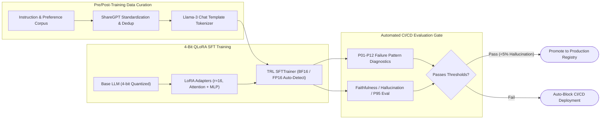
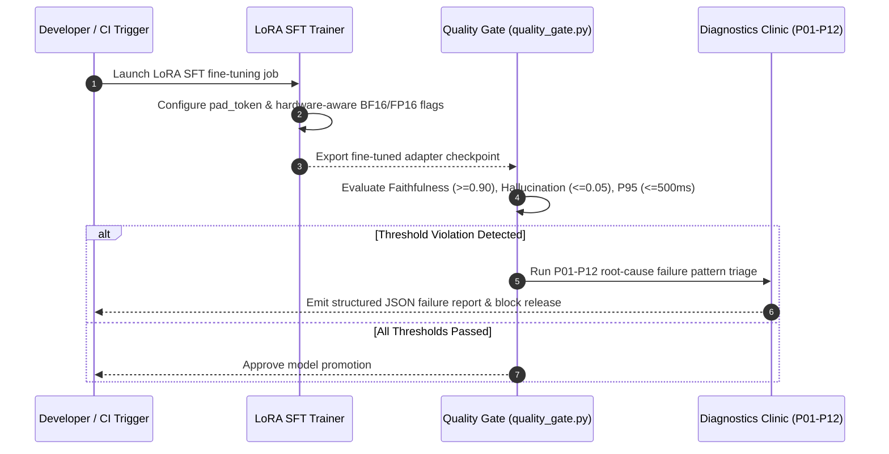

# End-to-End LLM SFT / LoRA Fine-Tuning & Automated CI/CD Evaluation Gate

[](#)
[](#)
[](#)
[](#)

Production **LLM Post-Training (SFT / LoRA / 4-bit QLoRA)** and **Automated CI/CD Quality Gate** pipeline. Combines ShareGPT chat-template standardization, LoRA adapter training across attention & MLP projections (`q_proj`, `k_proj`, `v_proj`, `o_proj`, `gate_proj`, `up_proj`, `down_proj`), P01–P12 RAG/LLM failure pattern diagnostics, and automated deployment blocking when hallucination or latency thresholds regress.

---

## Post-Training & CI/CD Quality Gate Architecture



---

## Evaluation & Triage Sequence Workflow



---

## Key Bug Fixes & Engineering Improvements

1. **Hardware-Safe BF16/FP16 Detection (`finetune_sft_lora.py`):** Guarded `torch.cuda.is_bf16_supported()` with `torch.cuda.is_available()` so importing or validating `SFTConfig` on CPU-only CI runners does not crash.
2. **Tokenizer Pad Token Initialization:** Explicitly assigned `tokenizer.pad_token = tokenizer.eos_token` when `pad_token is None`, resolving sequence padding errors during batched `DataCollatorForSeq2Seq` collation.
3. **Automated CI/CD Deployment Blocker (`quality_gate.py`):** Added deterministic threshold validation (`evaluate_ci_quality_gate`) and P01–P12 taxonomy verification (`validate_diagnosis_pattern_id`) with unit tests executed on every push via GitHub Actions.

---

## Quickstart

```bash
git clone https://github.com/shubh9119/llm-finetuning-eval-pipeline.git
cd llm-finetuning-eval-pipeline
pip install -r requirements.txt
pytest -v
```
